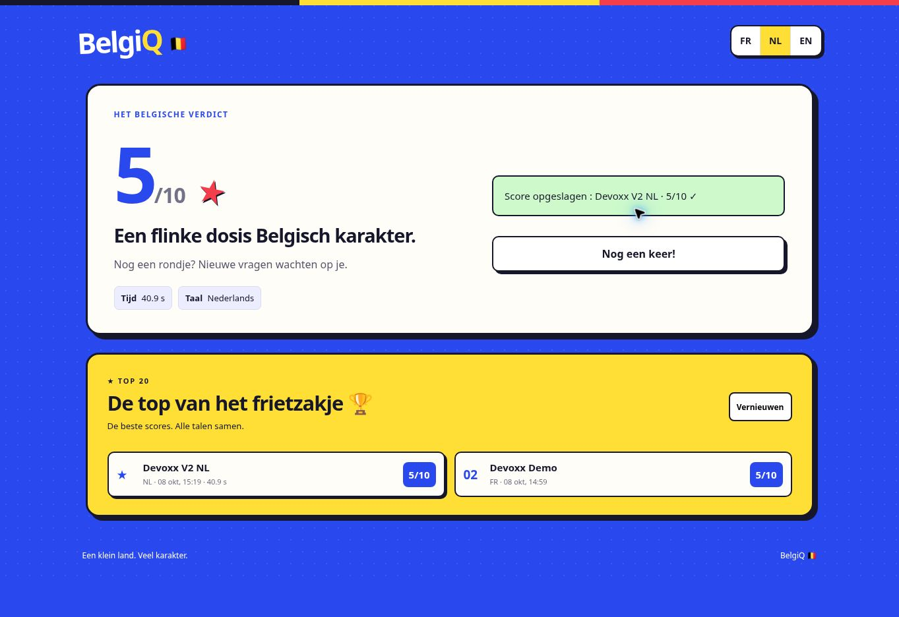

# BelgiQ 🇧🇪

A small multilingual quiz about Belgium, created as an AI-assisted side project during **Devoxx Belgium 2026** and deployed on **Clever Cloud**.

**[Try the live quiz](https://app-ffd5ff7b-b8c7-4a47-8c51-6a14f097f314.cleverapps.io/)**


## Features

- 20 questions about Belgian geography, history, food and culture
- 10 randomly selected questions per game, with immediate feedback
- French, Dutch and English interfaces and question translations
- Persistent leaderboard in PostgreSQL, with the best score per nickname
- Server-side score calculation and measured completion time
- Mobile-friendly UI

## Tech stack

- Node.js 22+, Express 5
- Vanilla HTML, CSS and JavaScript
- PostgreSQL (`pg`)
- Clever Cloud hosting

## Architecture

The Express server serves the frontend and a small JSON API. Game sessions are temporarily stored in server memory; completed scores are persisted to PostgreSQL. Answers and scores are validated/calculated server-side rather than trusted from the browser.

The database schema in `schema.sql` is applied at application startup. Existing scores are preserved by the V2 migration.

## Run locally

Prerequisites: Node.js **22+** and a running PostgreSQL database.

```bash
npm ci
cp .env.example .env
```

Set the PostgreSQL connection values in `.env`, then start the application:

```bash
node --env-file=.env server.js
```

Open <http://localhost:8080>. The server uses port 8080 by default, or `PORT` if set.

The app can alternatively use the `DATABASE_URL` environment variable.

## Tests

```bash
npm test
node --check server.js
node --check public/app.js
```

Automated tests cover the question catalogue, HTTP game flow, server-side scoring, duplicate saves and translation parity. The tests use a simulated database connection; integration with real PostgreSQL was separately checked during the original deployment.

## Screenshots



## Notes and limitations

- In-progress games are held in memory and expire after an hour; they do not survive an app restart. Saved leaderboard entries persist in PostgreSQL.
- The application was originally produced with ChatGPT assistance for a Devoxx/Clever Cloud experiment. This repository preserves the source from the deployed V2 version dated October 8, 2026.
- Never commit `.env` files, database passwords or Clever Cloud credentials. The `.env.example` file contains placeholders only.
